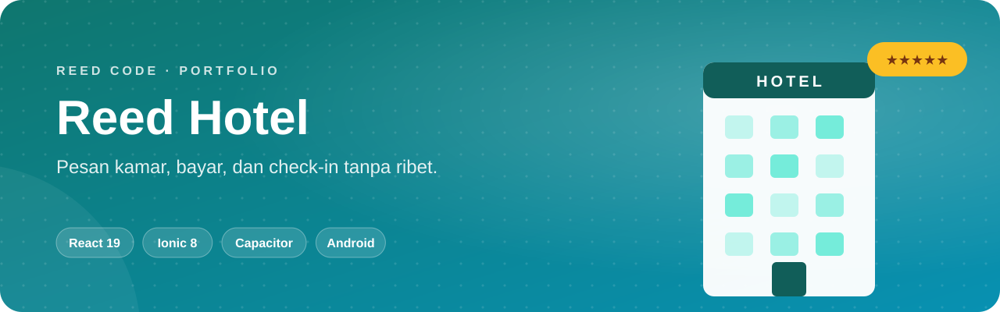
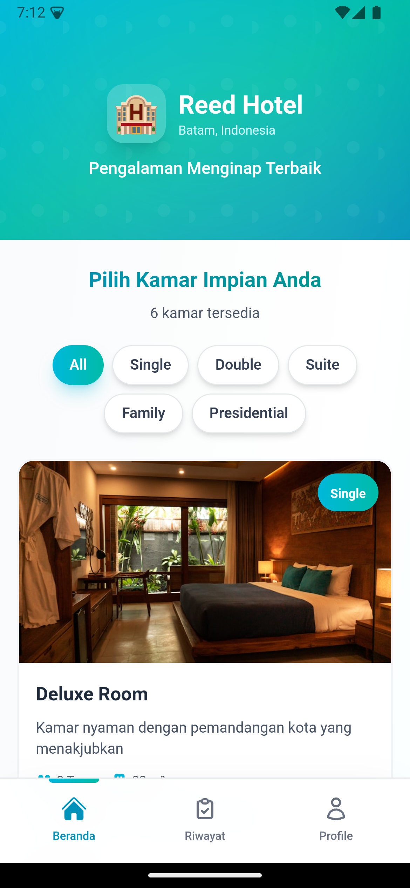
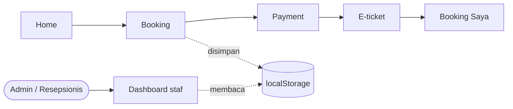

<p align="center">
  
</p>

<p align="center">
  <b>Dari memilih kamar sampai e-ticket, dalam beberapa ketukan.</b> Aplikasi reservasi hotel yang berjalan di browser maupun sebagai aplikasi Android.
</p>

<p align="center">
  <a href="#sekilas">Sekilas</a> ·
  <a href="#kemampuan">Kemampuan</a> ·
  <a href="#alur-kerja">Alur Kerja</a> ·
  <a href="#mulai-menjalankan">Mulai Menjalankan</a> ·
  <a href="#akun-demo">Akun Demo</a>
</p>

<p align="center">
  
  <br>
  
  
  
</p>

## Sekilas

**Reed Hotel** dibangun dengan React 19 + Ionic 8 dan dibungkus Capacitor untuk Android. Project ini **frontend-only**: data akun dan booking disimpan di `localStorage`, sehingga seluruh alur bisa dicoba tanpa server. Pembayaran berupa simulasi.

<p align="center">
  
</p>

## Kemampuan

<table>
  <tr>
    <td width="50%" valign="top"><b>🛏️ Katalog Kamar</b><br>Standard, Superior, Deluxe, Executive Suite, Family Room, dan Presidential Suite.</td>
    <td width="50%" valign="top"><b>📅 Booking</b><br>Pilih tanggal check-in, lama menginap, dan jumlah tamu.</td>
  </tr>
  <tr>
    <td valign="top"><b>💳 Simulasi Pembayaran</b><br>BCA, Mandiri, dan BNI Virtual Account, GoPay, OVO, DANA, serta QRIS.</td>
    <td valign="top"><b>🎫 E-Ticket</b><br>Bukti reservasi muncul setelah pembayaran.</td>
  </tr>
  <tr>
    <td valign="top"><b>🛎️ Dashboard Staf</b><br>Halaman khusus <b>Admin</b> dan <b>Resepsionis</b> untuk mengelola reservasi.</td>
    <td valign="top"><b>📱 Rasa Aplikasi Native</b><br>Bottom tab di mobile, layout responsif di desktop, dan route terproteksi per role.</td>
  </tr>
</table>

## Alur Kerja



## Mulai Menjalankan

> Butuh **Node.js 18+** dan npm.

```bash
git clone https://github.com/KyyStacy/hotel-reservation-ionic-react.git
cd hotel-reservation-ionic-react
npm install
npm run dev        # http://localhost:5173
```

<details>
<summary><b>Menjalankan sebagai aplikasi Android</b></summary>

<br>

Butuh **Android Studio** dan Android SDK.

```bash
npm run android:sync   # build web + sinkronisasi ke project Android
npm run android:open   # buka di Android Studio
npm run android:run    # jalankan di device/emulator yang terhubung
```

Script `android:run:emulator` dan `android:dev` memakai nama emulator tertentu (`--target`). Sesuaikan nama itu di `package.json`.

</details>

<details>
<summary><b>Perintah lain</b></summary>

<br>

| Perintah | Fungsi |
|---|---|
| `npm run build` | Build production ke `dist/` |
| `npm run test.unit` | Unit test (Vitest) |
| `npm run test.e2e` | End-to-end test (Cypress) |
| `npm run lint` | Cek kualitas kode |

</details>

## Akun Demo

| Role | Email | Password |
|---|---|---|
| Tamu | `user@test.com` | `user123` |
| Admin | `admin@reedhotel.com` | `admin123` |
| Resepsionis | `receptionist@reedhotel.com` | `receptionist123` |

Akun tamu baru juga bisa dibuat lewat halaman registrasi.

---

<div align="center">

<h2>Dibuat oleh Kyy Stacy × Reed Code</h2>

<p><i>Web & app developer: dari landing page sampai sistem bisnis custom.</i></p>

<a href="https://www.instagram.com/reedcode.id"></a>
<a href="https://www.tiktok.com/@reedcode.id"></a>
<a href="https://github.com/KyyStacy"></a>

<br><br>

<table>
  <tr>
    <td colspan="4" align="center"><b>Punya ide aplikasi atau butuh website untuk bisnismu?</b><br><sub>Reed Code siap bantu dari desain sampai online.</sub></td>
  </tr>
  <tr>
    <td align="center" width="25%">🌐<br><b>Company Profile</b><br><sub>Website brand & usaha</sub></td>
    <td align="center" width="25%">🛒<br><b>Toko Online</b><br><sub>Katalog & pembayaran online</sub></td>
    <td align="center" width="25%">📊<br><b>Sistem Bisnis</b><br><sub>Kasir, inventaris, booking</sub></td>
    <td align="center" width="25%">📱<br><b>Aplikasi Mobile</b><br><sub>Android & iOS</sub></td>
  </tr>
</table>

<a href="https://wa.me/6285171713355?text=Halo%20Reed%20Code%2C%20saya%20tertarik%20dengan%20jasa%20pembuatan%20website"></a>

<br><br>

<sub>© 2026 Kyy Stacy · Reed Code</sub>

</div>
